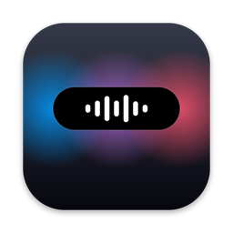
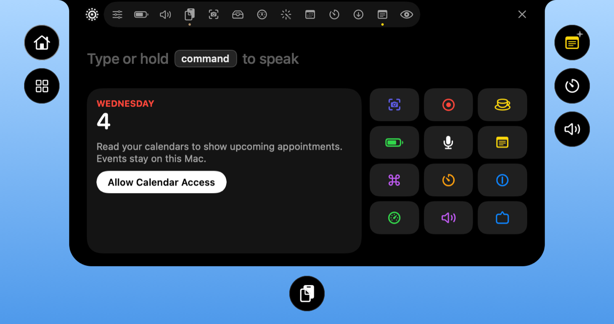
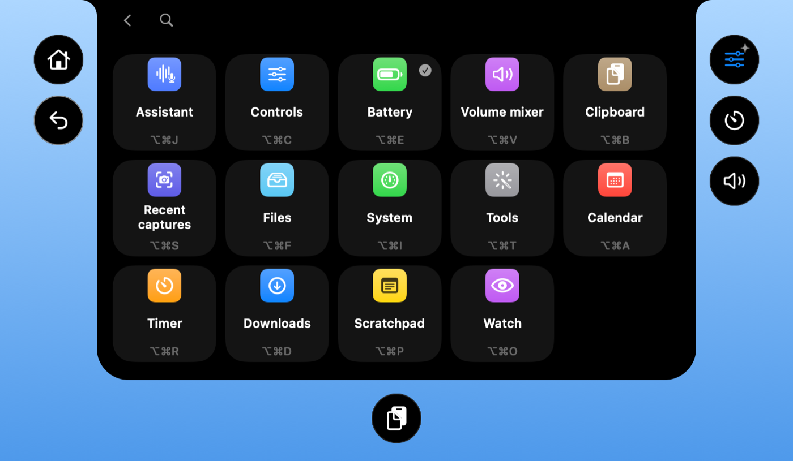
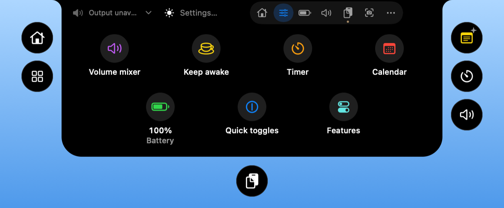
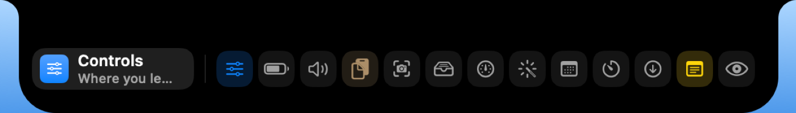
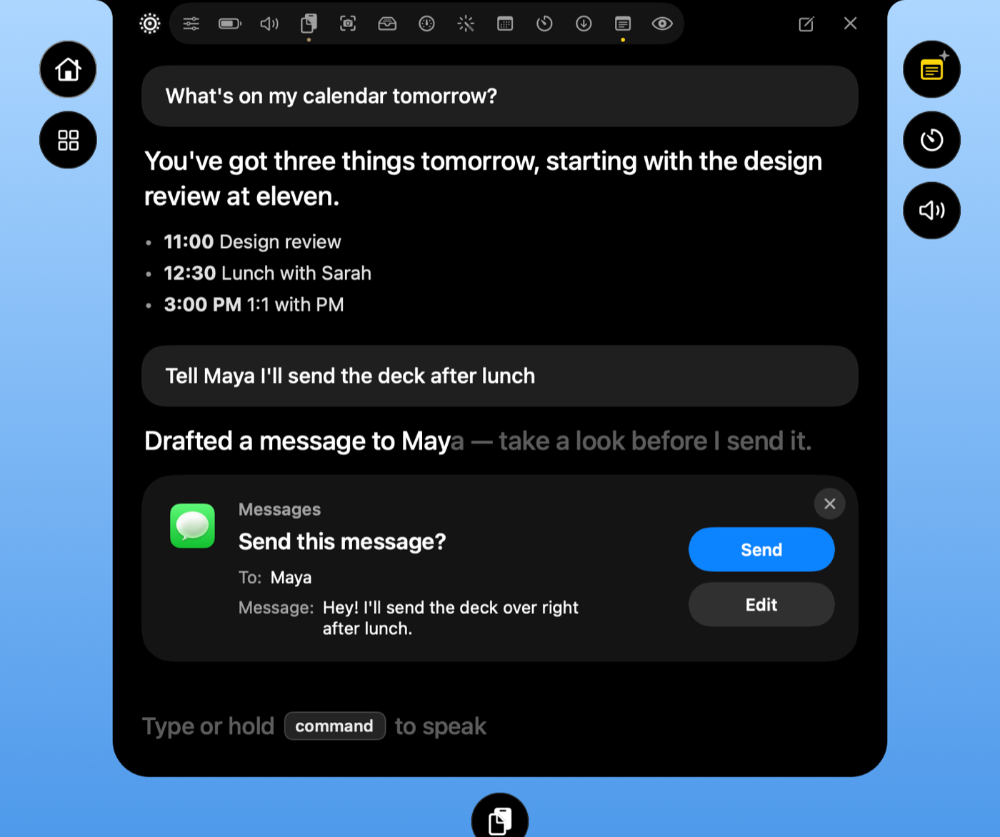
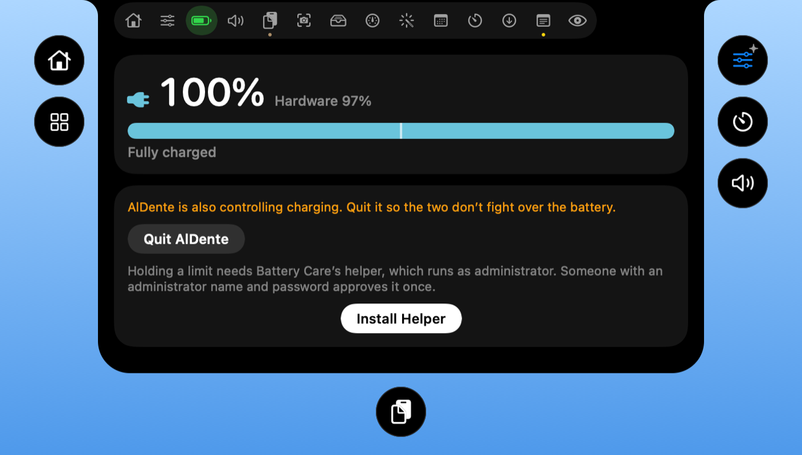
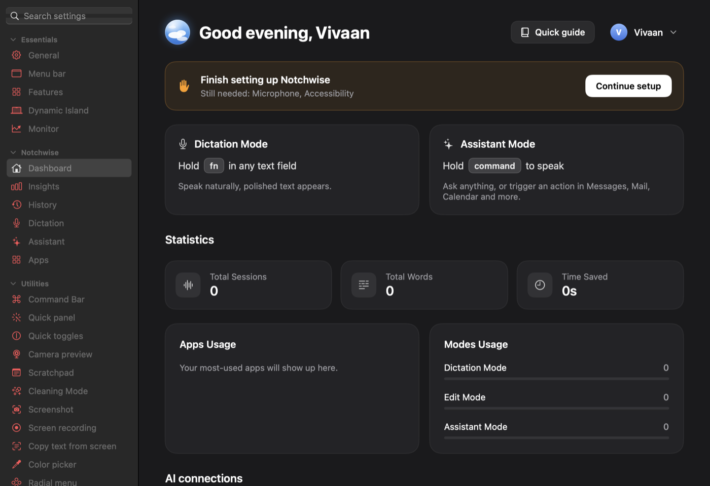

<p align="center">
  
</p>

<h1 align="center">Notchwise</h1>

<p align="center">
  <b>Your Mac's notch, finally useful.</b><br>
  A Dynamic Island, a private voice assistant and a toolbox of Mac utilities, in one app.
</p>

<p align="center">
  <a href="https://github.com/vivaanseth/notchwise/releases/latest"><b>Download</b></a> ·
  <a href="#getting-started">Getting started</a> ·
  <a href="#features">Features</a> ·
  <a href="#faq">FAQ</a> ·
  <a href="#build-from-source">Build from source</a>
</p>

<p align="center">
  <a href="https://github.com/vivaanseth/notchwise/releases/latest"></a>
  
  
  <a href="LICENSE"></a>
</p>

<p align="center">
  
</p>

## Why Notchwise

- **The notch becomes a place you use.** Hover over it and your day opens up: calendar, shortcuts, music, timers, files and more.
- **An assistant that respects your privacy.** Talk to it or type. It runs on a free model on your own Mac first, so most of what you say never leaves your computer.
- **One app instead of a dozen.** Volume mixer, system monitor, clipboard history, window snapping, screenshots, battery care and much more, all optional.
- **No account, no tracking, no subscription.** Everything stays on your Mac.

## Getting started

1. **Download** `Notchwise.dmg` from the [latest release](https://github.com/vivaanseth/notchwise/releases/latest).
2. **Open the disk image** and drag **Notchwise** into **Applications**.
3. **Open Notchwise.** It isn't notarized by Apple yet, so the first time, macOS asks you to confirm:
   - Right-click (or Control-click) Notchwise in Applications, choose **Open**, then **Open** again. Or
   - Open **System Settings → Privacy & Security**, scroll down and click **Open Anyway**.
4. **Follow the short setup.** Pick the features you want; Notchwise only asks for the permissions those features need.
5. **Move your pointer to the notch.** The island opens. Right-click it any time to customize what it shows.

> [!TIP]
> Want the voice assistant to run fully offline? Install [Ollama](https://ollama.com) and Notchwise will use a local model automatically. It opens Ollama only when you start talking, never at login.

## Features

### The island

A Dynamic Island for the Mac, designed after Apple's own: one look, one set of colours, and spring animations throughout.

<table>
  <tr>
    <td width="50%"></td>
    <td width="50%"></td>
  </tr>
  <tr>
    <td><b>Every page a click away.</b> Home, Controls, Now Playing, Calendar, Timer, Clipboard, Files, Downloads, Captures, Notifications, System, Volume mixer and Battery.</td>
    <td><b>Control Center on your notch.</b> Keep awake, timers, the mixer, quick toggles and more, lit up in colour while they're on.</td>
  </tr>
</table>

- **Live activities** for music (with bars that move to the actual audio), timers, downloads, meetings and AI agents at work.
- **Make it yours.** Right-click to remove any page, widget or shortcut and add it back later. What stays fills the space.
- **A hover dock.** Rest on the closed island to see every page, with the one you probably want first.

<p align="center">
  
</p>

### The assistant

<table>
  <tr>
    <td width="55%"></td>
    <td>
      <ul>
        <li><b>Hold a key and talk</b>, or just type. Answers appear in the island and can be read aloud.</li>
        <li><b>Local first.</b> A free model on your Mac handles what it can. Claude, ChatGPT and Gemini are optional, using the plan you already pay for.</li>
        <li><b>Gets things done.</b> Drafts messages, emails, notes, reminders and calendar events, and always asks before sending or changing anything.</li>
        <li><b>Dictation everywhere</b>, with clean-up on your Mac and a dictionary for names you use.</li>
      </ul>
    </td>
  </tr>
</table>

### Battery care

Keep your battery healthy: set a charge limit, let it sail between levels, top up for a trip, calibrate, and pause charging when it's hot. A power-flow view shows where every watt goes.

<p align="center">
  
</p>

> [!NOTE]
> Holding a charge limit needs a small helper that runs as administrator. Someone with an administrator password approves it once.

### Settings that make sense

<p align="center">
  
</p>

Install only the features you use: anything you turn off stops running and disappears. Every permission is explained in plain words, and Notchwise even tells you when a permission is no longer needed.

### Everything else

Click a category to see what's inside.

<details>
<summary><b>Sound</b></summary>

- **Volume mixer.** Set volume per app, boost quiet audio past 100%, and pin or reorder favorites. No audio driver required.
- **Per app output.** Play music through speakers while a call uses your headset.
- **Output switcher.** Switch audio outputs with a shortcut and lower the volume when headphones disconnect.
- **Microphone tools.** Choose a preferred input, adjust its level on supported devices, and mute all microphones with one shortcut.
- **Music app blocker.** Prevent unwanted Music launches after detected playback-button presses. Requires Accessibility.

</details>

<details>
<summary><b>Know what your Mac is doing</b></summary>

- **System monitor.** CPU, GPU, memory, temperatures, battery health and power use, with history graphs and a view of energy-hungry apps.
- **Fan Control (beta).** Set manual fan speeds or temperature curves and monitor live RPM.
- **Menu bar readouts.** Put your chosen readings, usage bars, battery time or fan speed directly in the menu bar.
- **Network.** See live traffic, session totals and your local IP address, or run a speed test.
- **Alerts.** Get notified about sustained CPU load, high temperatures, memory pressure, low disk space or low battery.

</details>

<details>
<summary><b>Windows and the Dock</b></summary>

- **App switcher.** Switch between apps and windows with live previews, search and display filters. A simpler mode works without screen capture.
- **Window layout.** Snap windows into layouts, move them between displays and restore earlier positions using shortcuts, screen edges or modifier-drag gestures.
- **Dock Preview.** Hover over Dock icons to preview windows across desktops. Switch, close, move or snap them from the preview.
- **Dock clicks.** Click an active app's Dock icon to minimize, hide or cycle through its windows.
- **Maximize windows.** Use the green button to fill the screen without creating another Space.
- **Fixed Space order.** Keep Spaces in the order you set instead of rearranging them by recent use. Turning it off restores your previous setting.
- **Quit on close.** Quit selected apps when their last window closes.
- **Quit and close protection.** Prevent accidental ⌘Q or ⌘W with a hold, double press or extra modifier, per app.

<p align="center">
  
</p>

<p align="center">
  
</p>

</details>

<details>
<summary><b>Keyboard and mouse</b></summary>

- **Text snippets.** Expand short triggers into text with clipboard, date and time variables, or insert snippets from a searchable menu.
- **Smooth scrolling.** Give your mouse wheel a fluid glide with adjustable speed and response.
- **Pointer acceleration.** Disable mouse acceleration and restore your previous setting when turned off.
- **Linear scrolling.** Make every mouse wheel notch scroll the same number of lines, however fast the wheel spins.
- **Focus follows mouse.** Bring the window under the pointer forward after an adjustable pause.
- **Scroll direction.** Invert vertical and horizontal mouse scrolling independently of the trackpad.
- **Scroll sideways while holding a key.** Turn vertical wheel movement into horizontal scrolling while holding a chosen key.
- **Side buttons.** Use mouse Back and Forward buttons in Finder, browsers and compatible apps.
- **Mouse button shortcuts.** Assign keys to extra buttons and side wheels, or use button-drag gestures for Spaces and Mission Control.
- **Middle click.** Turn a three-finger trackpad press into a middle click.
- **Apps to leave alone.** Exclude chosen apps from mouse enhancements.
- **Extra click filter.** Ignore accidental rapid clicks from worn mouse buttons without delaying normal clicks.
- **Key debounce.** Filter repeated letters caused by a worn keyboard.
- **Super key.** Use Caps Lock or a right-side modifier as a shortcut combination, with a separate tap action and app exclusions.
- **Keyboard shortcuts.** Manage feature shortcuts in one place, including optional takeover of supported macOS shortcuts while a feature is active.

</details>

<details>
<summary><b>Clipboard, files and links</b></summary>

- **Clipboard history.** Search local text, image and file history, pin favorites, preview entries and paste with shortcuts.
- **Auto clear clipboard.** Clear the system clipboard after a delay, sleep or lock, while keeping saved history.
- **Paste as plain text.** Paste without formatting while preserving the original clipboard content.
- **Shelf.** Park files, text and links near your cursor while dragging, then drop or share them later.
- **Finder shortcuts.** Move files with ⌘X and ⌘V, rename with F2, or paste copied images as PNG files.
- **Clean URL.** Remove tracking parameters from links, manually or automatically.
- **Disk image installer.** Install an app from a mounted disk image and eject it, with optional download cleanup.

</details>

<details>
<summary><b>Everyday tools</b></summary>

- **Dynamic Island.** Keep music, notifications, calendars, timers, downloads and everyday controls around the camera cutout, or a simulated one on other Macs. Customize sections and shortcuts, with optional lyrics, a live equalizer, camera preview and file tools.
- **AI agents.** Follow Claude, Codex, OpenCode and GitHub Copilot in the Dynamic Island: plan limits and when they reset where available, tokens, API value, models, projects and live work, with a notice when a long task finishes. Codex's banked resets can be used from there too, and each extra Codex account (`CODEX_HOME`) can have a limits card of its own. Copilot uses local CLI/app session logs; its token totals update when shutdown metrics arrive, and aggregate API-value estimates use base rates.
- **Command Bar.** Search apps, windows, files, clipboard history, snippets and app menu commands from one field. Calculate, convert units, find emoji or run saved scripts.
- **Quick panel.** Open a floating palette of favorite tools with ⌃⌘V.
- **Quick toggles.** Switch appearance, hide desktop icons, eject disks, empty the Trash, lock the screen and more.
- **Radial menu.** Open a customizable wheel of apps, files, shortcuts and tools around the pointer, with profiles and submenus.
- **Scratchpad.** Keep autosaved notes in tabs, with Markdown preview and export, in a floating window or Dynamic Island.
- **Cleaning Mode.** Lock keyboard input while cleaning, with a black screen or a small visible indicator.

</details>

<details>
<summary><b>Capture and create</b></summary>

- **Screen capture.** Switch between screenshots, recording, text recognition and color picking in one selector with a pixel magnifier.
- **Screenshot.** Capture an area, window, screen or scrolling page. Annotate, crop, redact, add backgrounds and watermarks, pin captures, send them through the Share menu or share an expiring link.
- **Screen recording.** Record with separate system-audio and microphone tracks. Trim, cut, add automatic zooms, blur private details and export video or GIFs, or share an expiring link.
- **Camera preview.** Check your camera in a floating mirror or Dynamic Island before a call.
- **Copy text from screen.** Recognize text offline from any screen area, or read a QR code.
- **Color picker.** Copy a screen color as HEX, RGB, HSL or SwiftUI code.
- **Media tools.** Compress and edit videos, batch-convert images, add watermarks, make GIFs and extract text, all locally.

</details>

<details>
<summary><b>App management</b></summary>

- **App updates.** Check store apps, package-managed apps and supported developer feeds in one list. Install managed updates together or open an app's own updater.
- **Cleaner.** Remove caches, logs and app leftovers, manually or on a schedule.
- **Messaging downloads.** Review, organize or move messaging downloads to the Trash using retention rules.
- **Uninstaller.** Remove apps and review their related caches, preferences and helpers before moving them to the Trash.
- **Homebrew manager.** Search, install and remove formulae and casks without opening a terminal.
- **Port manager.** Find processes listening on network ports and stop them with Kill Process when installed.

</details>

<details>
<summary><b>Energy and display</b></summary>

- **Keep awake.** Keep your Mac working on a timer, with the lid closed, or while selected apps, power or external displays are present.
- **Displays.** Control individual displays and brightness, with hardware control where supported, half or quarter steps for the brightness keys, optional extra dimming below a monitor's minimum, and software dimming as a fallback.
- **Extra brightness.** Use a MacBook Pro XDR display's HDR headroom to go beyond its normal maximum brightness.
- **Bluetooth on sleep.** Disconnect Bluetooth during sleep and restore it on wake only if Notchwise turned it off.

</details>

## Privacy

Notchwise works on your Mac, without an account, analytics or tracking. It only goes online for things you ask for: a speed test, Homebrew actions, song lyrics if you turn them on, and the cloud AIs you choose to connect. Read the details in the [privacy notes](docs/PRIVACY.md) and the [permissions guide](docs/PERMISSIONS.md).

## FAQ

<details>
<summary><b>Which Macs does it run on?</b></summary>

Any Mac with macOS 14 Sonoma or later, Apple Silicon or Intel. The download is a universal app. The island looks best on a Mac with a notch, and works as a floating capsule on other displays.
</details>

<details>
<summary><b>macOS says it can't check Notchwise for malicious software.</b></summary>

Notchwise isn't notarized by Apple yet. Right-click it in Applications and choose **Open**, or click **Open Anyway** in System Settings → Privacy & Security. You only need to do this once.
</details>

<details>
<summary><b>Does the assistant need the internet or a paid AI?</b></summary>

No. With [Ollama](https://ollama.com) installed, it runs on a free local model. Connecting a cloud AI is optional.
</details>

<details>
<summary><b>How do I update?</b></summary>

Download the newest release and replace the app in Applications. Your settings and permissions carry over.
</details>

<details>
<summary><b>How do I uninstall it?</b></summary>

Use **Uninstall Notchwise completely** in Settings → Advanced to remove the app and everything it set up, or drag it to the Trash.
</details>

## Build from source

You need the Xcode Command Line Tools (`xcode-select --install`).

```sh
git clone https://github.com/vivaanseth/notchwise.git
cd notchwise
./Tools/setup-signing.sh   # once: a local signing identity, so permissions survive rebuilds
./build.sh                 # builds build/stage/Notchwise.app
./build.sh --test          # runs the test suites
```

See the [contributing guide](CONTRIBUTING.md) for the project layout, and [the island's design](docs/ISLAND_DESIGN.md) for its visual rules.

## Help and feedback

Found a bug or have an idea? [Open an issue](https://github.com/vivaanseth/notchwise/issues/new). The [troubleshooting guide](docs/TROUBLESHOOTING.md) covers the common fixes, and security issues go through the [security policy](SECURITY.md).

## Credits

Notchwise is built on **[Vorssaint](https://github.com/vorssaint/vorssaint-utils)**, a free, open-source Mac utility by Vorssaint, licensed under GPL-3.0-or-later. Its menu bar utilities and the original island come from Vorssaint 3.4.2. Notchwise adds the voice assistant, universal builds, Battery Care, island customization, the redesign and many fixes. Notchwise is an independent project and is not affiliated with or endorsed by Vorssaint.

The assistant's design is inspired by VoiceOS. Notchwise is not affiliated with, endorsed by or connected to VoiceOS or its makers.

## License

Notchwise is free software under the [GNU GPL 3.0 or later](LICENSE). Copyright © 2026 Vivaan; portions copyright © 2026 Vorssaint. See [TRADEMARKS.md](TRADEMARKS.md) for names and branding.
